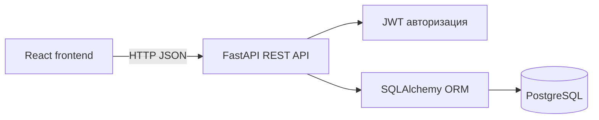

# петяtoy — магазин игрушек

Учебный full-stack проект интернет-магазина игрушек. Пользователь может посмотреть каталог, найти игрушку, отфильтровать товары по категории и возрасту, добавить товары в корзину и оформить заказ.

## Возможности

### Для покупателя

- регистрация и вход в аккаунт;
- каталог игрушек с фотографиями и описаниями;
- поиск по названию и описанию;
- фильтр по категории и возрасту;
- корзина и оформление заказа;
- история заказов;
- страницы «Контакты» и «О нас».

### Для администратора

- добавление товаров;
- удаление товаров из каталога;
- просмотр всех заказов;
- изменение статуса заказа;
- переход в админ-панель из шапки сайта.

## Технологии

- Frontend: React, TypeScript, Vite, CSS;
- Backend: Python, FastAPI, Pydantic, SQLAlchemy;
- Database: PostgreSQL;
- Авторизация: JWT и хеширование паролей;
- Запуск: Docker Compose;
- Тесты: pytest.

## Структура проекта

```text
backend/       REST API на FastAPI
frontend/      клиентская часть на React
docs/          документация и отчёты по этапам
docker-compose.yml
README.md
```

## Запуск через Docker — пошагово

Понадобятся Docker Desktop и Git. Команды ниже вводятся в приложении **Терминал** на macOS.

### Один раз: скачать проект

Сначала открой Docker Desktop и дождись, пока он полностью запустится.

Затем открой **Терминал** и выполни эти команды:

```bash
git clone https://github.com/pvts19/petya-toy-store.git
cd petya-toy-store
```

Если проект уже скачан, повторно выполнять `git clone` не нужно. Достаточно открыть Терминал и перейти в папку проекта:

```bash
cd petya-toy-store
```

### Терминал №1: запустить Docker

В первом окне Терминала выполни:

```bash
docker compose up --build
```

Оставь это окно открытым. В нём будут отображаться сообщения Docker. Это нормально.

### Терминал №2: заполнить базу товарами

Открой второе окно Терминала сочетанием клавиш `Cmd + T`.

Во втором окне снова перейди в папку проекта:

```bash
cd petya-toy-store
```

Затем выполни команду заполнения базы:

```bash
docker compose exec backend python -m app.seed
```

Если всё прошло успешно, появится сообщение:

```text
Тестовые данные добавлены
```

### Открыть сайт

Не закрывая Docker в первом терминале, открой браузер и перейди по адресу:

<http://localhost:5173>

Дополнительные адреса:

- API: <http://localhost:8000>
- Документация API: <http://localhost:8000/docs>
- PostgreSQL с компьютера: порт `5433`.

### Как остановить проект

Вернись в **Терминал №1** и нажми `Ctrl + C`.

Чтобы снова запустить проект позже, открой Терминал, перейди в папку проекта и выполни:

```bash
cd petya-toy-store
docker compose up
```

## Администратор

Для демонстрации используется тестовая учётная запись:

```text
Email: admin@toystore.local
Пароль: admin12345
```

После входа в правом верхнем углу появится кнопка «Админка».

## Запуск без Docker

Backend:

```bash
cd backend
python -m venv .venv
source .venv/bin/activate
pip install -r requirements.txt
python -m app.seed
uvicorn app.main:app --reload
```

Frontend в отдельном окне терминала:

```bash
cd frontend
npm install
npm run dev
```

## О проекте

### Назначение системы

«петяtoy» — учебное веб-приложение для продажи детских игрушек. Система объединяет каталог товаров, регистрацию пользователей, корзину, оформление заказов и административное управление магазином.

Главная цель проекта — показать полный путь покупателя: от просмотра каталога до оформления заказа. Администратор при этом может управлять товарами и отслеживать заказы.

### Роли пользователей

| Роль | Возможности |
|---|---|
| Гость | Просмотр каталога, поиск, фильтры, страницы «Контакты» и «О нас», регистрация и вход |
| Покупатель | Всё, что доступно гостю, а также корзина, оформление заказа и история своих заказов |
| Администратор | Добавление и удаление товаров, просмотр заказов и изменение их статусов |

## Функциональные требования

| Код | Требование | Реализация |
|---|---|---|
| FR-01 | Регистрация и вход | Пользователь создаёт аккаунт, входит и выходит из системы |
| FR-02 | Каталог | Товары отображаются карточками с фотографией, названием, возрастом, описанием и ценой |
| FR-03 | Категории | Можно выбрать категорию: конструкторы, плюшевые игрушки, настольные игры или другое |
| FR-04 | Поиск | Поиск работает по названию и описанию товара |
| FR-05 | Фильтрация | Товары фильтруются по категории и возрасту ребёнка |
| FR-06 | Корзина | Авторизованный пользователь добавляет и удаляет товары, а сумма пересчитывается автоматически |
| FR-07 | Оформление заказа | Пользователь вводит имя, телефон и адрес доставки |
| FR-08 | История заказов | Пользователь видит только свои заказы и их статусы |
| FR-09 | Управление товарами | Администратор добавляет и удаляет товары из каталога |
| FR-10 | Управление заказами | Администратор просматривает заказы и меняет их статусы |
| FR-11 | Остатки | Нельзя заказать больше товара, чем есть на складе |

## Нефункциональные требования

- интерфейс адаптируется под компьютер, планшет и узкий экран;
- frontend не подключается к базе данных напрямую;
- все запросы между frontend и backend выполняются через REST API;
- пароли не хранятся в открытом виде, а сохраняются в виде хеша;
- административные операции доступны только пользователю с ролью `admin`;
- backend предоставляет документацию OpenAPI/Swagger;
- приложение запускается через Docker Compose.

## Архитектура



Frontend находится в папке `frontend` и отвечает за интерфейс магазина. Все обращения к серверу собраны в файле `frontend/src/api.ts`.

Backend находится в папке `backend`. Он проверяет данные, права пользователей, наличие товаров и создаёт заказы.

PostgreSQL хранит пользователей, категории, товары, корзины и заказы.

## Основные сущности базы данных

### User — пользователь

- `id` — идентификатор;
- `email` — адрес электронной почты;
- `password_hash` — хеш пароля;
- `name` — имя пользователя;
- `role` — роль `customer` или `admin`.

### Category — категория

- `id` — идентификатор;
- `name` — название категории;
- `description` — описание категории.

Текущие категории магазина: «Конструкторы», «Плюшевые игрушки», «Настольные игры» и «Другое».

### Product — товар

- `id` — идентификатор;
- `category_id` — категория товара;
- `name` — название;
- `description` — описание;
- `price` — цена;
- `stock` — количество на складе;
- `age_from` — минимальный возраст;
- `image_url` — путь к фотографии;
- `is_active` — доступен ли товар в каталоге.

### CartItem — товар в корзине

Связывает пользователя с товаром и хранит выбранное количество.

### Order — заказ

Хранит пользователя, итоговую сумму, контактные данные, адрес и статус заказа.

### OrderItem — состав заказа

Хранит название, цену и количество товара на момент покупки. Поэтому старый заказ не изменится, даже если цена товара в каталоге позже поменяется.

## REST API

### Авторизация

```text
POST /api/auth/register   регистрация пользователя
POST /api/auth/login      вход и получение JWT-токена
GET  /api/auth/me         данные текущего пользователя
```

### Категории

```text
GET    /api/categories              список категорий
POST   /api/categories              создать категорию, только администратор
PATCH  /api/categories/{id}         изменить категорию, только администратор
DELETE /api/categories/{id}         удалить категорию, только администратор
```

### Товары

```text
GET    /api/products                 каталог товаров
GET    /api/products/{id}            один товар
POST   /api/products                 добавить товар, только администратор
PATCH  /api/products/{id}            изменить товар, только администратор
DELETE /api/products/{id}            скрыть товар, только администратор
```

Для каталога используются параметры поиска и фильтров:

```text
GET /api/products?search=lego&category=2&age=6
```

### Корзина

```text
GET    /api/cart                    получить корзину пользователя
POST   /api/cart                    добавить товар
PATCH  /api/cart/{product_id}       изменить количество
DELETE /api/cart/{product_id}       удалить товар
```

### Заказы

```text
POST  /api/orders                   оформить заказ
GET   /api/orders                   история заказов пользователя
GET   /api/admin/orders             все заказы для администратора
PATCH /api/admin/orders/{id}        изменить статус заказа
```

## Пользовательские сценарии

### Сценарий 1: покупка товара

1. Гость открывает каталог.
2. Находит игрушку через поиск или фильтр.
3. Нажимает «В корзину».
4. Если пользователь не авторизован, сайт предлагает войти или зарегистрироваться.
5. Пользователь открывает корзину.
6. Вводит имя, телефон и адрес.
7. Подтверждает заказ.
8. Заказ появляется в истории пользователя.

### Сценарий 2: работа администратора

1. Администратор входит через кнопку «Войти».
2. В верхней части сайта появляется кнопка «Админка».
3. Администратор может добавить новый товар.
4. У каждой карточки появляется кнопка удаления товара.
5. В нижней части страницы отображаются заказы.
6. Статус заказа можно изменить в выпадающем списке.

## Статусы заказа

| Статус | Значение |
|---|---|
| `new` | Новый заказ |
| `confirmed` | Заказ подтверждён |
| `processing` | Заказ собирается |
| `shipped` | Заказ передан в доставку |
| `completed` | Заказ завершён |
| `cancelled` | Заказ отменён |

## Демонстрационные товары

После выполнения команды `app.seed` в каталоге появляются:

- Lego City «Космическая станция» — от 12 лет;
- «Морской бой» — от 6 лет;
- плюшевый медведь — от 0 лет;
- деревянная железная дорога — от 3 лет;
- большой конструктор Lego Duplo.

Для товаров используются локальные изображения из папки `frontend/public/images`.

## Проверка проекта

Проверка frontend-сборки:

```bash
docker compose exec frontend npm run build
```

Запуск backend-тестов без Docker:

```bash
cd backend
pip install -r requirements-dev.txt
pytest
```

## Ограничения учебной версии

- онлайн-оплата не подключена;
- доставка моделируется обычным текстовым адресом;
- уведомления пользователю по email не отправляются;
- фотографии хранятся локально в проекте;
- администраторская учётная запись является демонстрационной;
- для полноценного запуска необходим Docker Desktop.
