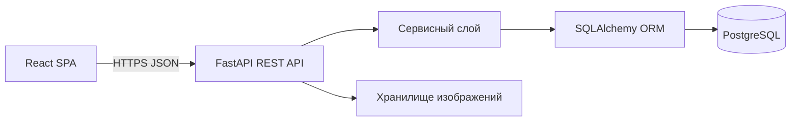
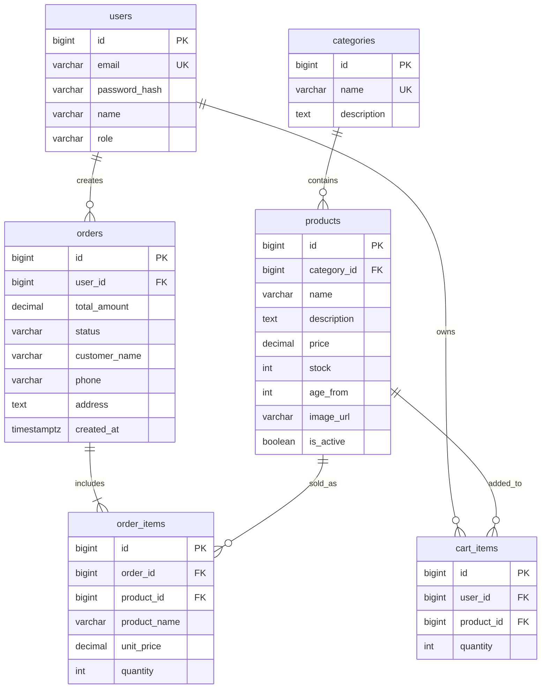

# Неделя 1 — аналитика и проектирование

## Цель недели

Зафиксировать предметную область и подготовить договорённости, по которым будут создаваться backend и frontend.

## Результаты

- сформулирована цель ToyStore;
- определены роли и границы MVP;
- составлены функциональные и нефункциональные требования;
- определены основные сущности базы данных;
- согласован REST-подход и стек;
- подготовлен план следующих недель.

## План проекта

| Неделя | Результат |
|---|---|
| 1 | ТЗ, сценарии, ER-модель, архитектура и API-контракт |
| 2 | Backend: модели, миграции, авторизация, каталог и корзина |
| 3 | Frontend: каталог, карточка товара, корзина и авторизация |
| 4 | Заказы, личный кабинет и административная часть |
| 5 | Интеграция, тестирование, адаптивность и исправление замечаний |
| 6 | Docker, Swagger, демонстрационный стенд и финальная документация |

## Архитектура



Frontend не обращается к базе напрямую. Все запросы идут через слой `frontend/src/api`. Backend отвечает за авторизацию, проверку прав, бизнес-правила корзины и заказов.

## ER-модель



`order_items` хранит название и цену на момент покупки, чтобы старые заказы не менялись при редактировании товара.

## Черновой API-контракт

| Метод | Endpoint | Назначение |
|---|---|---|
| POST | `/api/auth/register` | регистрация |
| POST | `/api/auth/login` | вход и получение JWT |
| POST | `/api/auth/logout` | выход |
| GET | `/api/categories` | список категорий |
| GET | `/api/products` | каталог с поиском и фильтрами |
| POST/PUT/DELETE | `/api/products` | управление товарами администратора |
| GET/POST/PATCH/DELETE | `/api/cart` | работа с корзиной |
| POST | `/api/orders` | оформление заказа |
| GET | `/api/orders` | заказы текущего пользователя |
| PATCH | `/api/admin/orders/{id}` | изменение статуса администратором |

Параметры каталога:

```text
GET /api/products?search=конструктор&category=2&min_price=500&max_price=3000&age=6&ordering=-price&page=1
```

## Критерии готовности недели

- любой разработчик понимает назначение системы и роли;
- MVP можно проверить по таблице требований в `REPORT.md`;
- сущности и связи базы данных согласованы до начала реализации;
- frontend и backend используют единый список endpoint'ов;
- после недели 1 можно начинать разработку API без изменения предметной области.

